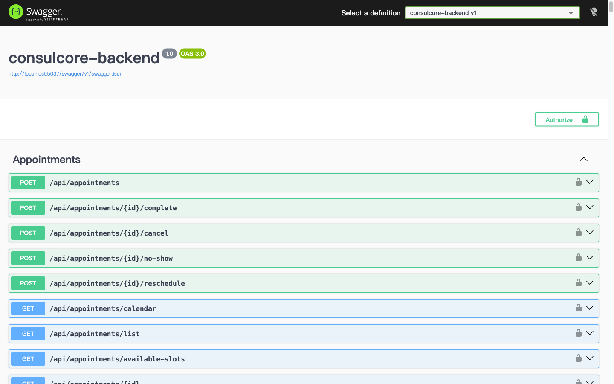
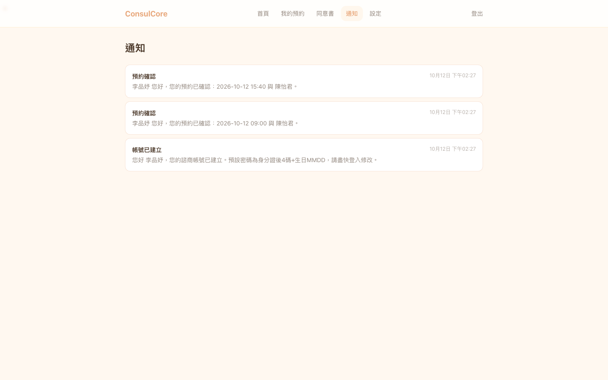
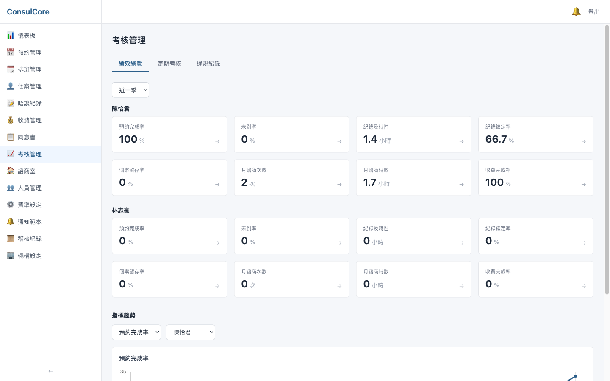
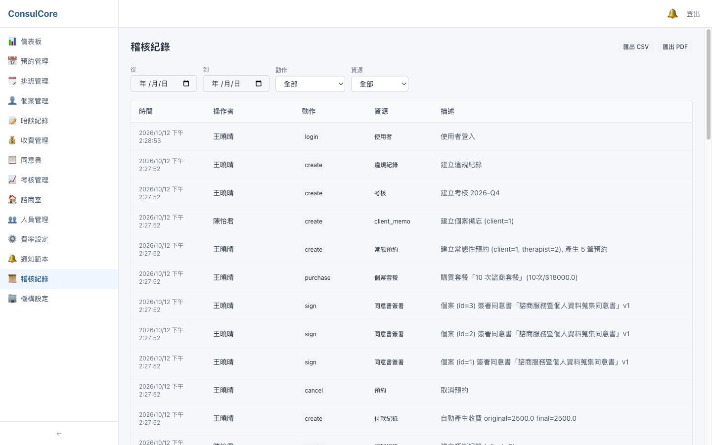

# 整合測試報告 — Backend

> 測試日期：2026-10-12　｜　版本：`main` @ `eca0dc3`　｜　前端對應版本：`consulcore-frontend` `main` @ `f70b503`
>
> 畫面操作測試、各頁截圖與 UI 問題清單見前端報告：`consulcore-frontend/docs/test-report.md`

## 總覽

| 項目 | 結果 | 說明 |
|------|------|------|
| 建置（`dotnet build`，警告視為錯誤） | ✅ 0 警告 0 錯誤 | .NET SDK 10.0.401 |
| 單元 + API 整合測試（`dotnet test`） | ✅ 173 / 173 通過 | 單元 9 個測試類別、API 整合 35 個測試類別 |
| 端對端情境（`tests/integration-test.sh`） | ✅ 73 / 73 通過 | 對實際執行中的 API 與 SQLite 檔 |
| OpenAPI 契約（`OpenApiContractTests`） | ✅ 一致 | `openapi.json` 與程式碼相符，前端型別由此產生 |
| 示範資料（`scripts/seed-demo.py`） | ✅ 成功 | 全程走 API；資料已存在時立即失敗並顯示原因 |
| CI（GitHub Actions） | ✅ `main` 通過 | 建置、測試、端對端 |

測試期間發現的問題：後端 2 項、與前端共同 1 項，詳見[發現的問題](#發現的問題)。

## 測試環境

- macOS、.NET SDK 10.0.401、SQLite（每次測試使用全新的暫存資料庫，不碰開發用的 `App_Data`）
- API：`dotnet run --launch-profile http`（http://localhost:5037）
- 金鑰：由 gitignored 的 `appsettings.Development.json` 提供

## 1. 自動化測試（xUnit）

`tests/ConsulCore.Tests`，以 `WebApplicationFactory` 起完整 API（暫存 SQLite），透過 HTTP 驗證行為。

| 類別 | 涵蓋內容（測試類別） |
|------|------|
| 認證與帳號安全 | 登入限流與失敗稽核（`LoginSecurity`）、隨機初始密碼（`ClientAccountCredentials`）、強制改密碼（`MustChangePassword`）、停用帳號立即失效（`DeactivatedAccount`）、JWT 金鑰檢查（`JwtSecretKey`）、沒有 Email 的個案帳號（`ClientAccountEmail`） |
| 權限與隔離 | `X-Active-Role` 偽造提權（`PermissionPolicy`）、權限碼目錄一致（`AuthorizationCatalog`）、多租戶隔離（`TenantIsolation`）、個案資料範圍（`ClientScope`）、擁有者保護（`OwnerProtection`）、收費與通知的擁有權（`BillingAccess`、`NotificationOwnership`、`OwnershipRejectionStatus`）、表單範本權限、心理師下拉清單（`TherapistOptions`） |
| 業務規則 | 收費冪等（`BillingIdempotency`）、時段樂觀併發與唯一性（`SlotConcurrency`、`ScheduleSlotUniqueness`）、軟刪除（`SoftDelete`）、續約提醒（`RenewalReminder`）、診所時區（`ClinicClock*`）、報表數字（`ReportCharacterization`） |
| API 品質 | 分頁與上限（`PagedList`、`PagingBounds`）、日期參數（`DateParameter`）、模型驗證回應格式（`ValidationResponse`）、例外對應狀態碼（`ErrorHandlingMiddleware`）、追蹤碼（`CorrelationId`）、健康檢查（`HealthAndDelivery`、`HealthController`）、OpenAPI 契約 |
| 基礎設施 | AES-256-GCM 加解密（`AesEncryptionService`）、資料庫 provider 切換（`DatabaseProvider`）、啟動設定檢查、權限種子資料、CSV 輸出 |

```text
已通過! - 失敗: 0，通過: 173，略過: 0，總計: 173
```

## 2. 端對端情境（`tests/integration-test.sh`）

對執行中的 API 跑完整業務流程，並直接查 SQLite 確認敏感欄位是密文。

| 情境 | 步驟 |
|------|------|
| 1. 新機構從零開始 | 開設機構 → 診間 × 3 → 心理師 × 2 + 行政 → 指派診間 → 排班範本 → 展班 → 費率 / 套餐 / 同意書 / 折扣 → 預設表單與 24 筆通知範本 |
| 2. 完整個案生命週期 | 建立個案與帳號 → 初始密碼登入 → 強制改密碼 → 初談預約 → 簽同意書 → 填初談表單 → 完成晤談、寫 SOAP、鎖定 → 自動產生收費 → 收款 → 購買套餐 → 常態預約 → 套餐扣抵 → 個案備忘 |
| 3. 權限測試 | 心理師不能管理人員、行政不能看稽核、未登入 401 等 |
| 3b. 個案存取隔離 | 個案只看得到自己的預約、同意書、常態預約 |
| 4. 心理師離職 | 個案移轉給其他心理師、結案 |
| 邊界情境 | 重複預約同一時段（E1）、同意書內容快照（E2）、解鎖修改再鎖定留稽核（E3）、重複展班略過（E4）、資料庫欄位已加密 |

```text
 通過: 73 / 73
 失敗: 0 / 73
 ★ ALL TESTS PASSED ★
```

## 3. 示範資料與 API 文件

`python3 scripts/seed-demo.py` 透過 API 建立一間示範診所（人員、6 位個案、排班、預約、晤談紀錄、收費、同意書、考核），前端報告的截圖都使用這份資料。資料庫已有示範帳號時會立即失敗：

```text
建立示範資料失敗：POST /auth/register → 400：此使用者名稱已被使用
```

開發環境的 Swagger UI（`/swagger`）：



## 發現的問題

自動化測試全部通過；以下是用示範資料實際操作畫面時發現、與後端有關的問題，**尚未修正**，待確認處理方式。

### B1. 「帳號已建立」通知內容仍寫舊的初始密碼規則（高）

開設機構時寫入的通知範本內容是「預設密碼為身分證後4碼+生日MMDD」，但初始密碼早已改為隨機產生（D11）。個案收到的通知會誤導，也透露了已廢止的密碼規則。

- 位置：`Data/DatabaseSeeder.cs` 的預設通知範本（`AccountCreated`），開設機構時複製給該機構
- 建議：範本內容改為「初始密碼由櫃檯提供，首次登入需變更」；已存在的機構需另外更新範本內容



### B2. 預約完成率把尚未到來的預約算進分母（中）

考核頁同一位心理師：績效總覽顯示預約完成率 100%，指標趨勢的同一個月卻是 33.3%。兩邊公式相同（已完成 ÷ 區間內全部預約），差在區間：趨勢以整個月份計算，把月底前還沒發生的「已排定」預約也算進分母（3 ÷ 9）。

- 位置：`PerformanceService.GetMetricsAsync`
- 建議：分母只計已過時間的預約（或排除 `scheduled`）

| 績效總覽（近一季） | 指標趨勢（同月 33.3%） |
|---|---|
|  |  |

### B3. 稽核紀錄的動作、資源與描述以程式代碼呈現（低，與前端共同）

動作欄顯示 `login`、`create`、`sign`，資源有未翻譯的 `client_memo`，描述含 `(client=1)`、`original=2500.0 final=2500.0` 等開發用格式。稽核紀錄需要給機構負責人閱讀與匯出，應以中文與易讀的金額呈現。

- 建議：前端對動作與資源代碼做中文對照；後端描述改用個案姓名以外的易讀格式（避免在稽核描述寫入個資）並將金額格式化



### 已知限制（非本次問題）

- Email / 簡訊通知尚未串接（#14），目前只記錄為「待寄送」
- `Down` migration `NullableUserEmail`：同機構有多個沒有 Email 的帳號時無法退回（見 PR #17）
- `npm audit` 的 braces（high）來自前端的 lint 工具，上游尚無修正版，不影響執行環境
