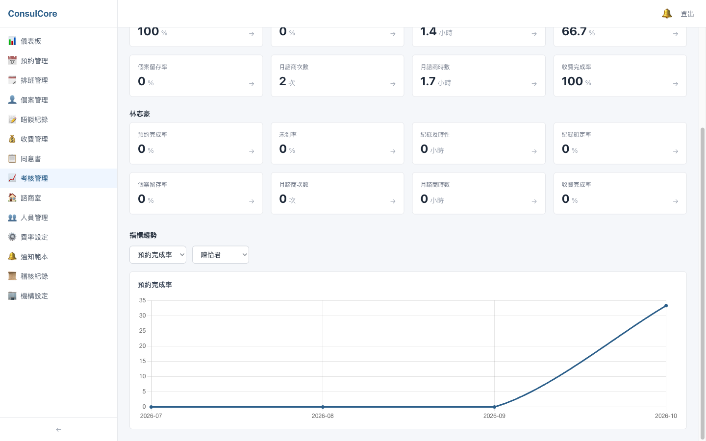

# 整合測試報告 — Backend

> 測試日期：2026-10-12　｜　最終版本：`main` @ `b83427f`　｜　前端對應版本：`consulcore-frontend` `main` @ `a26a403`
>
> 流程：第一輪測試找出問題 → 修正（後端 PR #19、#20）→ 以最終版本重跑全部測試與截圖。本報告的數字與截圖皆為最終版本。
>
> 畫面操作測試、各頁截圖與 UI 問題清單見前端報告：`consulcore-frontend/docs/test-report.md`

## 總覽

| 項目 | 結果 | 說明 |
|------|------|------|
| 建置（`dotnet build`，警告視為錯誤） | ✅ 0 警告 0 錯誤 | .NET SDK 10.0.401 |
| 單元 + API 整合測試（`dotnet test`） | ✅ 180 / 180 通過 | 單元 9 個測試類別、API 整合 37 個測試類別（第一輪 173，修正時新增 7） |
| 端對端情境（`tests/integration-test.sh`） | ✅ 73 / 73 通過 | 對實際執行中的 API 與 SQLite 檔 |
| OpenAPI 契約（`OpenApiContractTests`） | ✅ 一致 | `openapi.json` 與程式碼相符，前端型別由此產生 |
| 示範資料（`scripts/seed-demo.py`） | ✅ 成功 | 全程走 API；資料已存在時立即失敗並顯示原因 |
| CI（GitHub Actions） | ✅ `main` 通過 | 建置、測試、端對端 |

第一輪發現與後端有關的問題 3 項，修正過程中另外發現 1 項，**全部已修正**，詳見[發現的問題與修正](#發現的問題與修正)。

## 測試環境

- macOS、.NET SDK 10.0.401、SQLite（每次測試使用全新的暫存資料庫，不碰開發用的 `App_Data`）
- API：`dotnet run --launch-profile http`（http://localhost:5037）
- 金鑰：由 gitignored 的 `appsettings.Development.json` 提供

## 1. 自動化測試（xUnit）

`tests/ConsulCore.Tests`，以 `WebApplicationFactory` 起完整 API（暫存 SQLite），透過 HTTP 驗證行為。

| 類別 | 涵蓋內容（測試類別） |
|------|------|
| 認證與帳號安全 | 登入限流與失敗稽核（`LoginSecurity`）、隨機初始密碼（`ClientAccountCredentials`）、強制改密碼（`MustChangePassword`）、停用帳號立即失效（`DeactivatedAccount`）、JWT 金鑰檢查（`JwtSecretKey`）、沒有 Email 的個案帳號（`ClientAccountEmail`） |
| 機構設定 | 機構基本資料讀取、更新、權限、驗證與稽核（`OrganizationSettings`） |
| 權限與隔離 | `X-Active-Role` 偽造提權（`PermissionPolicy`）、權限碼目錄一致（`AuthorizationCatalog`）、多租戶隔離（`TenantIsolation`）、個案資料範圍（`ClientScope`）、擁有者保護（`OwnerProtection`）、收費與通知的擁有權（`BillingAccess`、`NotificationOwnership`、`OwnershipRejectionStatus`）、表單範本權限、心理師下拉清單（`TherapistOptions`） |
| 業務規則 | 收費冪等（`BillingIdempotency`）、時段樂觀併發與唯一性（`SlotConcurrency`、`ScheduleSlotUniqueness`）、軟刪除（`SoftDelete`）、續約提醒（`RenewalReminder`）、診所時區（`ClinicClock*`）、報表數字（`ReportCharacterization`）、績效指標分母（`PerformanceMetrics`） |
| API 品質 | 分頁與上限（`PagedList`、`PagingBounds`）、日期參數（`DateParameter`）、模型驗證回應格式（`ValidationResponse`）、例外對應狀態碼（`ErrorHandlingMiddleware`）、追蹤碼（`CorrelationId`）、稽核描述格式（`AuditDescription`）、通知範本內容（`NotificationTemplate`）、健康檢查（`HealthAndDelivery`、`HealthController`）、OpenAPI 契約 |
| 基礎設施 | AES-256-GCM 加解密（`AesEncryptionService`）、資料庫 provider 切換（`DatabaseProvider`）、啟動設定檢查、權限種子資料、CSV 輸出 |

```text
已通過! - 失敗: 0，通過: 180，略過: 0，總計: 180
```

## 2. 端對端情境（`tests/integration-test.sh`）

對執行中的 API 跑完整業務流程，並直接查 SQLite 確認敏感欄位是密文。

| 情境 | 步驟 |
|------|------|
| 1. 新機構從零開始 | 開設機構 → 診間 × 3 → 心理師 × 2 + 行政 → 指派診間 → 排班範本 → 展班 → 費率 / 套餐 / 同意書 / 折扣 → 預設表單與 24 筆通知範本 |
| 2. 完整個案生命週期 | 建立個案與帳號 → 初始密碼登入 → 強制改密碼 → 初談預約 → 簽同意書 → 填初談表單 → 完成晤談、寫 SOAP、鎖定 → 自動產生收費 → 收款 → 購買套餐 → 常態預約 → 套餐扣抵 → 個案備忘 |
| 3. 權限測試 | 心理師不能管理人員、行政不能看稽核、未登入 401 等 |
| 3b. 個案存取隔離 | 個案只看得到自己的預約、同意書、常態預約 |
| 4. 心理師離職 | 個案移轉給其他心理師、結案 |
| 邊界情境 | 重複預約同一時段（E1）、同意書內容快照（E2）、解鎖修改再鎖定留稽核（E3）、重複展班略過（E4）、資料庫欄位已加密 |

```text
 通過: 73 / 73
 失敗: 0 / 73
 ★ ALL TESTS PASSED ★
```

## 3. 示範資料與 API 文件

`python3 scripts/seed-demo.py` 透過 API 建立一間示範診所（人員、6 位個案、排班、預約、晤談紀錄、收費、同意書、考核），前端報告的截圖都使用這份資料。資料庫已有示範帳號時會立即失敗：

```text
建立示範資料失敗：POST /auth/register → 400：此使用者名稱已被使用
```

開發環境的 Swagger UI（`/swagger`）：


## 發現的問題與修正

以下是用示範資料實際操作畫面時發現、與後端有關的問題。每項都先寫出會失敗的測試，再修正。

| # | 問題 | 嚴重度 | 修正 | 測試 |
|---|---|---|---|---|
| B1 | 「帳號已建立」通知仍寫「預設密碼為身分證後4碼+生日MMDD」，但初始密碼早已改為隨機產生 | 高 | #19 | `NotificationTemplateTests` |
| B2 | 同一位心理師，績效總覽的預約完成率 100%、趨勢圖同月 33% | 中 | #19、#20 | `PerformanceMetricsTests` |
| B3 | 稽核描述是 `client=1`、`original=2500.0` 這類開發用格式 | 低 | #19、#20 | `AuditDescriptionTests` |
| B4 | 端對端腳本在 API 沒起來時，錯誤訊息本身讓腳本以 `unbound variable` 中止 | 低 | #20 | 手動以不存在的 `DB_PATH` 驗證 |

### B1. 「帳號已建立」通知寫著已廢止的初始密碼規則

預設通知範本（`Data/DatabaseSeeder.cs`，開設機構時複製給該機構）沿用舊規則，個案會被誤導，也等於公開了舊規則。改為「初始密碼由櫃檯提供，首次登入時需設定新密碼」。正式環境尚無既有機構，不需回寫。

| 修正前 | 修正後 |
|---|---|
|  |  |

### B2. 預約完成率的分母

公式是「已完成 ÷ 區間內預約」，但兩個畫面的區間不同：總覽算到今天，趨勢圖算整個月份。月底前還沒發生的「已排定」預約（#19 修正）與提前取消的預約（#20 修正，重新截圖時才發現仍有 75% 對 100% 的差異）都會被算進趨勢圖的分母。

改為「已完成 ÷（已完成 + 未出席）」：只計該出席的預約，與查詢區間是否延伸到未來無關。未到率同步調整，欄位說明寫在 OpenAPI。

| 修正前（趨勢圖同月 33%） | 修正後（與總覽一致，100%） |
|---|---|
|  |  |

### B3. 稽核描述

統一改為「建立預約（個案 #1、時段 #5）」「自動產生收費：原價 2,500 元，應收 2,500 元」；仍只寫編號不寫姓名，避免稽核描述帶出個資。#19 只搜尋了 `key=value` 寫法，重新截圖時發現「購買套餐（$18000.0）」等 3 處漏網，#20 補齊，測試也改為斷言所有描述都沒有 `數字.0`。動作與資源代碼的中文顯示由前端處理（前端報告 F9）。

| 修正前 | 修正後 |
|---|---|
|  |  |

### B4. 端對端腳本的錯誤訊息

`$DB_PATH` 後緊接全形「（」，bash 會把全形字元併入變數名，`set -u` 下直接中止，看不到「找不到 SQLite 資料庫」的提示。示範用的 API 占用 5037 port、測試用 API 起不來時遇到。改為 `${DB_PATH}`。

### 新增：機構基本資料 API

前端報告 F11 需要可以編輯機構名稱、電話、Email、地址。新增 `GET / PUT /api/organization`（需要 `org.settings`，預設只有擁有者），機構 id 一律取自 JWT，更新留稽核並記錄前後內容。

### 修正過程中的一次不穩定結果

修正 B2 時，有一次完整測試出現 2 個失敗，但緊接著連續重跑 4 次都全部通過，未能重現，也沒有留下失敗的測試名稱。CI 與之後的所有本機執行皆通過；若再出現，需記下測試名稱追查。

### 已知限制（非本次問題）

- Email / 簡訊通知尚未串接（#14），目前只記錄為「待寄送」
- `Down` migration `NullableUserEmail`：同機構有多個沒有 Email 的帳號時無法退回（見 PR #17）
- `npm audit` 的 braces（high）來自前端的 lint 工具，上游尚無修正版，不影響執行環境
